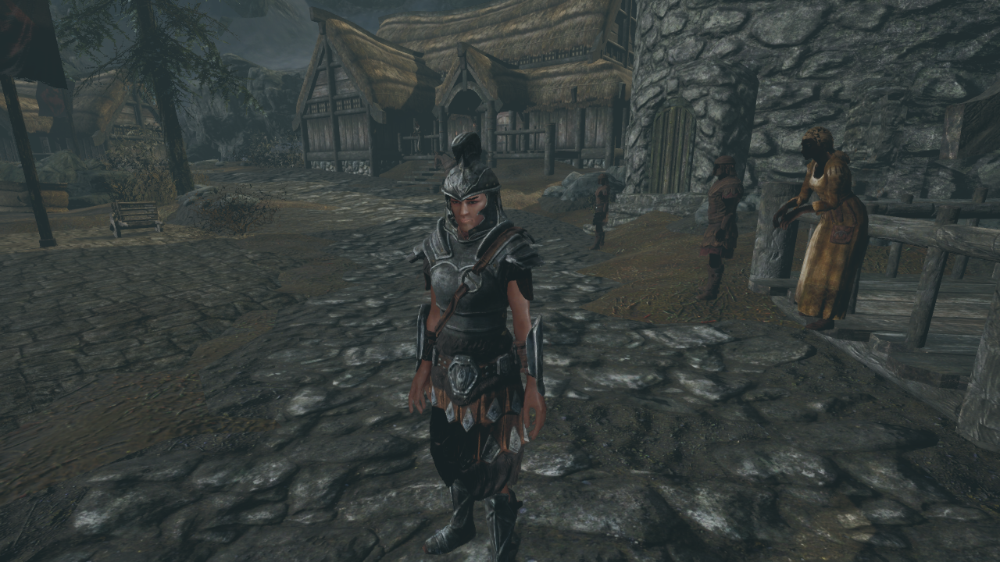
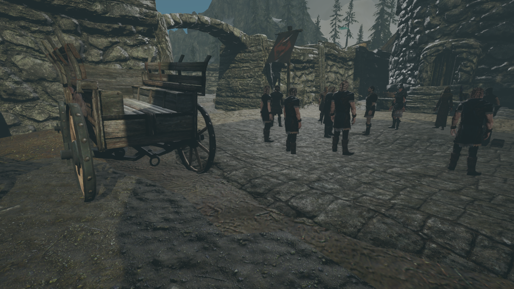

# T54UE

T54UE is an experimental Windows x64 project that recreates parts of Skyrim in Unreal Engine 5.8. The T5Data plugin reads maps, models, voice audio, and Papyrus scripts from a local installation of Skyrim Special Edition or Anniversary Edition. Quest and Papyrus support is still partial.

## Screenshots

| Helgen street during the opening | Helgen courtyard |
| --- | --- |
|  |  |

These screenshots were captured in T54UE. The Skyrim artwork shown belongs to its respective rights holders.

## Set up the game data

Copy the entire `Data` folder from your own Skyrim SE/AE installation. Place it next to `T54UE.uproject` when working from source. For a standalone Windows package you build locally, place it next to the outer `T54UE.exe`.

```text
T54UE/                         Windows/
├── T54UE.uproject             ├── T54UE.exe
└── Data/                      ├── T54UE/
    ├── Skyrim.esm             └── Data/
    └── ...                        └── Skyrim.esm
```

The folder needs the game archives and the five master files `Skyrim.esm`, `Update.esm`, `Dawnguard.esm`, `HearthFires.esm`, and `Dragonborn.esm`. T54UE finds `Data` automatically and uses its built-in load order. A base installation is sufficient.

A Windows directory junction also works. Run this command from the project directory or the directory containing the outer `T54UE.exe` and substitute the path to your Skyrim installation.

```powershell
New-Item -ItemType Junction -Path .\Data -Target 'C:\Games\Skyrim Special Edition\Data'
```

For existing saves, point the junction at the original Skyrim `Data` folder. Save compatibility checks include the paths to the game files.

## Build and run from source

You need Unreal Engine 5.8, the MSVC x64 game development toolchain, the Windows SDK, and a compatible T5DataBridge build.

1. Place `Data` next to `T54UE.uproject`. Check out the `bridge` branch of the companion repository next to T54UE. [T5Bridge](https://github.com/maksidze/T5Bridge)

   ```text
   workspace/
   ├── T5Bridge/
   │   ├── Build.ps1
   │   └── CMakeLists.txt
   └── T54UE/
       ├── T54UE.uproject
       └── Data/
   ```

2. Install CMake and extract the `vcpkg-x64-windows-2022-2026-10-10.7z` OpenMW dependency archive. Use the extracted directory as `$Dependencies`. The build script defaults to the Visual Studio 2026 x64 generator. [OpenMW dependency release](https://github.com/OpenMW/openmw-deps-build/releases/tag/2026-10-10)

3. Build and start T54UE from PowerShell in the client checkout. Set `$UERoot` to your Unreal Engine 5.8 installation.

   ```powershell
   $UERoot = 'C:\Program Files\Epic Games\UE_5.8'
   $Dependencies = 'C:\deps\vcpkg-x64-windows-2022-2026-10-10'
   .\Build.ps1 -UnrealRoot $UERoot -Dependencies $Dependencies
   $Project = (Resolve-Path .\T54UE.uproject).Path
   & "$UERoot\Engine\Binaries\Win64\UnrealEditor.exe" $Project -game -T5NewGame -T5Quest=0003372B -T5PapyrusContinueOnMissingNative
   ```

   The script builds the native bridge in `../T5Bridge/build`, installs its local runtime in `Plugins/T5Data/Binaries/ThirdParty/Win64`, and builds the Unreal target. Pass `-Backend <path>` for a different checkout location or `-Target Game` to compile the Win64 game target.

   To open the editor, launch `UnrealEditor.exe` with the project path alone. To open the project by double-clicking it, use **Switch Unreal Engine version** in the context menu for `T54UE.uproject` and select your local UE 5.8 installation.

Logs from the editor are in `Saved/Logs`. If the catalog fails to load, look for `Skyrim Data directory not found` or `Plugin listed but absent from Data` and check the path or file named in the message.

## Run a locally built Windows package

After packaging from Unreal Editor, open the directory containing the outer `T54UE.exe` in PowerShell.

```powershell
# Start the opening sequence
.\T54UE.exe -T5NewGame -T5Quest=0003372B -T5PapyrusContinueOnMissingNative

# Continue the latest save
.\T54UE.exe -T5LoadGame -T5PapyrusContinueOnMissingNative

# Choose a save
.\T54UE.exe -T5SelectSave -T5PapyrusContinueOnMissingNative
```

Launching without arguments opens the world viewer. Press **M** to browse locations. The package stores logs and saves in its inner `T54UE/Saved` directory.

If you package to `Saved/StagedBuilds/Windows`, the package can use `Data` from the source project's root. `RunGame.bat`, `ContinueGame.bat`, and `RaceMenu.bat` in the project root launch that package.

See the [T5Data documentation](Plugins/T5Data/README.md) for runtime details and diagnostic options.

## Repository contents and licensing

This repository contains project source, tools, and the T5Data startup map and materials. Executables, native libraries, Windows packages, Skyrim's `Data` folder, local game imports, and optional RaceMenu files are supplied or built locally.

- **T54UE.** The project's original client source is licensed under the [MIT License](LICENSE). The Epic templates retain their original notices. Game artwork shown in the screenshots belongs to its respective rights holders.
- **OpenMW.** `T5DataBridge` is built from the separate T5Bridge fork. OpenMW-derived code is licensed under GPLv3 and retains its upstream notices. [OpenMW](https://openmw.org/faq/)
- **Current integration.** The locally built Unreal client loads the bridge DLL in its own process. License compatibility for that combination remains a separate consideration under Epic's terms. [Unreal Engine EULA §6(c)](https://www.unrealengine.com/eula/unreal)
